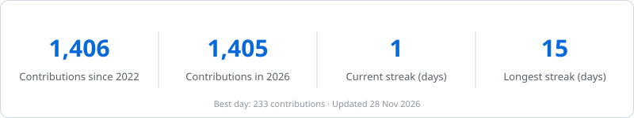
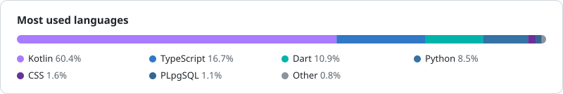

<h1 align="center">Hey, I'm Oghosa Benedict 👋</h1>

  <b>Mobile & full-stack developer</b> — I build Android, Flutter and web apps end to end, from the database schema to the last pixel.

  

---

### 🧠 About me

- 📱 I ship **native Android** apps with Kotlin & Jetpack Compose, and **cross-platform** apps with Flutter
- 🌐 I build **web apps** with React, TypeScript and Vite, and desktop apps with Electron
- 🗄️ I design backends on **Supabase / PostgreSQL** — Auth, Realtime, Storage and proper Row Level Security
- 🤖 I build **AI-powered tools**: agent builders, LLM tool-calling and on-device chess engines
- 🎨 I care about design: every app gets a real visual identity, not a template
- 💬 Ask me about chess engines, Compose UI, or Postgres RLS

---

### 🛠️ Tech stack

   
   
   
  

---

### 🚀 Featured projects

| Project | What it is | Built with |
| --- | --- | --- |
| ♟️ **[Chess Tutor](https://github.com/Bennykent21/Chess-tutor-app)** | A chess teacher on your phone: 12 human-like bots, 73 interactive lessons, 13,000+ puzzles and Stockfish 19 game reviews — fully offline, no account, no ads | Kotlin · Jetpack Compose · Room · Stockfish |
| 🎓 **[UNICON](https://github.com/Bennykent21/unicon-campus-app)** | A campus community app: Q&A, marketplace, jobs, events and real-time chat for university students | Flutter · Riverpod · Supabase |
| 🧩 **[AgentForge](https://github.com/Godsent0001/agent-forge)** | A desktop builder for recursive AI agent hierarchies, where agents can become tools for other agents | Electron · React · TypeScript · Python |
| 🌐 **[Chess Tutor Web](https://github.com/Bennykent21/chess-tutor-web)** | The browser version of Chess Tutor: coach-first training board, bots and review | React · TypeScript · Vite · Supabase |

---

### 📊 GitHub stats

  

  

  <picture>
    <source media="(prefers-color-scheme: dark)" srcset="https://raw.githubusercontent.com/Bennykent21/Bennykent21/output/snake-dark.svg">
    
  </picture>

---

### 🤝 Let's connect

  
  
  
  
  

<i>Always building something. Open to collaborations and new ideas.</i>

